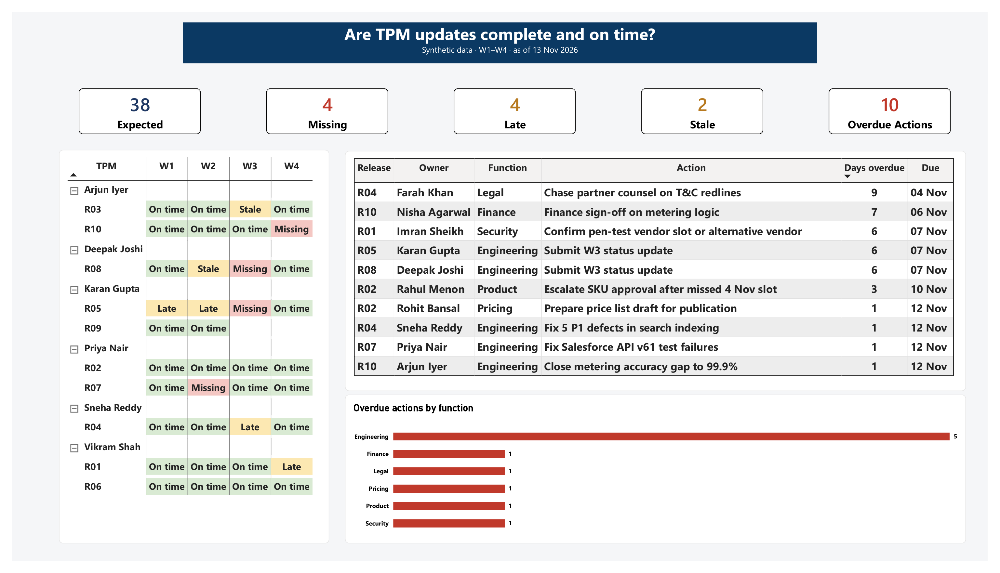
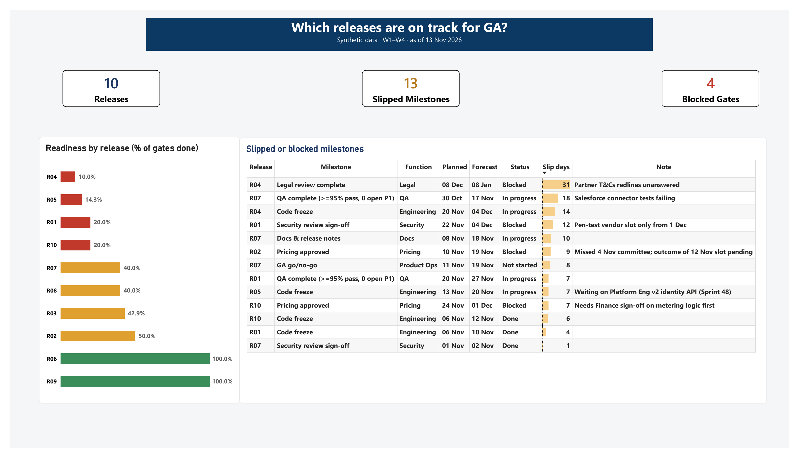
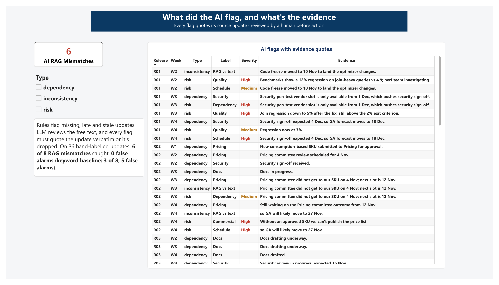

# AI Product Ops Command Centre (ReleaseOps)

**A weekly release status process for a product organisation: rules check whether status updates are complete and on time, AI checks whether they are honest, and a dashboard plus a leadership summary say what needs a decision.**

> All releases, people and figures are **synthetic and fictional**. The dataset was built for this project to mimic a software product org running 10 releases at once.



---

## The problem

Product organisations run many releases in parallel. Every week each Technical Program Manager (TPM) sends a status update: a **RAG colour** (Red / Amber / Green) plus a few lines of text. Product Operations then has to:

- chase updates that are **missing, late or copy-pasted** from last week
- spot **misreported RAGs**, for example "Green" while the text describes a slip or a blocker
- track **readiness gates** (QA, security, pricing, legal, marketing) and **overdue cross-functional actions**
- tell leadership **what changed and what needs a decision**

Done by hand, this takes hours a week, and misreported RAGs still slip through.

## What it does

| Step | How | Output |
|---|---|---|
| **1. Intake** | Excel workbook, Jira-style export, Microsoft Forms import (validated) | 10 releases · 72 milestones · 36 TPM updates · 27 action items |
| **2. Rule checks** (no AI) | Python + Power Query | 38 expected updates: **4 missing, 4 late, 2 stale** · readiness % by release type · **13 slipped/blocked milestones** · **10 overdue actions** |
| **3. AI review** | Claude reads each update's free text. **Every flag must quote the update verbatim, or it is dropped** | RAG-vs-text mismatches, open risks, cross-team dependencies, decision requests |
| **4. Eval** | AI vs keyword baseline vs a hand-labelled answer key | Precision / recall (below) |
| **5. Leadership summary** | AI, restricted to the supplied facts | *Needs a decision* · *What changed* · *Who owes what* |
| **6. Follow-ups** | Templates (deliberately **not** AI) | One draft per person, **human approval before sending** |
| **7. Dashboard** | Power BI (3 pages) | Reporting hygiene · Readiness & risks · AI review & evidence |

One command runs steps 1–6: `python src/run_weekly.py`

## Results

Evaluated on **36 TPM updates**, labelled by hand as the answer key.

| Task | Method | Caught | False alarms | Missed | Precision | Recall |
|---|---|---|---|---|---|---|
| **Misreported RAG** (8 cases) | Keyword baseline | 3 | 5 | 5 | 38% | 38% |
| | **AI (Claude)** | **6** | **0** | 2 | **100%** | **75%** |
| **Open risk** (16 cases) | Keyword baseline | 13 | 5 | 3 | 72% | 81% |
| | **AI (Claude)** | **16** | **0** | 0 | **100%** | **100%** |
| **Dependencies** (24) | AI (Claude) | 23 | **10** | 1 | 70% | 96% |

- **Citation guardrail:** 0 of the AI's flags were dropped, so every flag quoted its source text correctly.
- **Leadership summary:** fact-checked line by line against the data; no invented facts. Where a deadline wasn't in the data, it said "not stated" instead of guessing.

### What the results mean

1. **The AI beats keywords where it matters.** It caught twice as many misreported RAGs with zero false alarms. Keywords fail on negations ("no escalations"), resolved blockers ("the blocker is resolved") and problems described without warning words ("the pricing committee did not get to our SKU").
2. **Both AI misses were Amber-vs-Red judgement calls**, not missed problems. The org had no written RAG criteria, so the reviewer and the AI drew the line differently. **The fix is a process fix (a one-line RAG rubric), not a better model.**
3. **The AI over-flags dependencies** (10 false alarms). For example, "Docs drafting underway" got flagged as a dependency on the Docs team. This is the main thing to fix in v2.

## Design decisions

- **Rules first, AI only for free text.** Dates, deadlines, gates and overdue items are deterministic, so rules handle them: cheaper, faster and exactly right. AI is used only for what rules can't do: reading text.
- **Follow-ups use templates, not AI.** Their content is fully set by the rules (who, what, which date), so a template can't hallucinate and costs nothing.
- **Every AI flag must quote its evidence verbatim.** Flags without a matching quote are dropped automatically.
- **Risks are kept separate from decisions.** A risk is what could go wrong; a decision is what leadership must act on. Decisions go at the top of the summary so they aren't buried in a risk list.
- **Humans approve before anything is sent.** Follow-ups are drafts; nothing goes out automatically.

## Dashboard

**Readiness & risks:** readiness % by release (red/amber/green) and slipped or blocked milestones, with slip days as data bars.



**AI review & evidence:** every AI flag with the exact quote behind it, filterable by type.



The Power BI file is in `dashboard/ReleaseOps_Dashboard.pbix` (a PDF export is alongside it). The "expected updates" table is built in **Power Query**: releases × reporting weeks, then matched against actual submissions. Anything without a match is missing, and anything after the Thursday 18:00 deadline is late.

## How to run

**Requirements:** Python 3.10+, `pip install pandas openpyxl`

```bash
python src/run_weekly.py                       # rules → AI step → eval → summary → follow-ups
python src/run_weekly.py --form "responses.xlsx"   # import new Microsoft Forms responses first
python src/run_weekly.py --llm api             # hands-off AI step (needs ANTHROPIC_API_KEY)
```

**AI step without an API key:** the script writes prompt batches to `prompts/`. Paste each into a new Claude chat, save the reply into `responses/`, and run the command again. Only new or changed batches need pasting.

To reproduce the eval numbers above without running the AI again: `python src/eval.py` (it uses the saved replies in `responses/`).

## Repository structure

```
data/         dataset workbook, Jira-style export, answer key (ground_truth.csv), label review sheet
src/          rules.py · llm_flags.py · eval.py · weekly_summary.py · followups.py · ingest_form.py · run_weekly.py
prompts/      prompts sent to the AI (instructions + updates)
responses/    the AI's raw replies (so the eval is reproducible)
outputs/      rule outputs, AI flags, eval results, leadership summary, follow-up drafts
dashboard/    Power BI file, PDF export, page images
samples/      sample Microsoft Forms export for testing the import
build/        scripts that generate the synthetic dataset
```

## Limitations (stated honestly)

- **Synthetic data.** The updates were written for this project and deliberately include cases that keyword search gets wrong (negations, hidden risks). That favours the AI over the baseline.
- **Small sample.** 36 updates; one error moves a metric by roughly 10–20 points. Counts are shown alongside percentages for that reason.
- **No real users yet.** Accuracy is measured; time saved and user acceptance are not.
- **Not scheduled.** The weekly run is one command plus a one-click dashboard refresh; it is not set up to run on a timer.
- **Milestone data is a static snapshot** (as of 13 Nov 2026). In real use it would come from a weekly Jira export.

## Roadmap (v2)

- [ ] Tighten the dependency definition in the prompt; re-run and report before vs after
- [ ] Add 15–20 updates written blind as a held-out test set
- [ ] Compare a smaller vs a larger model on accuracy, cost per run and speed
- [ ] Test with 3–5 real PMs: share of flags accepted, minutes saved
- [ ] Write a RAG rubric and re-label the Amber-vs-Red cases against it

## Tech stack

Python (pandas, openpyxl) · Claude (LLM) · Excel / Power Query · Power BI · Microsoft Forms

## Author

**Sagnic Mandal** · [LinkedIn](https://www.linkedin.com/in/sagnic-mandal-072ab4165/)

Built with AI pair-programming assistance (Claude) for code and synthetic data. Problem framing, the answer-key labels, evaluation, analysis and the dashboard are my own.
